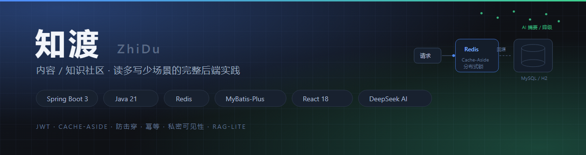
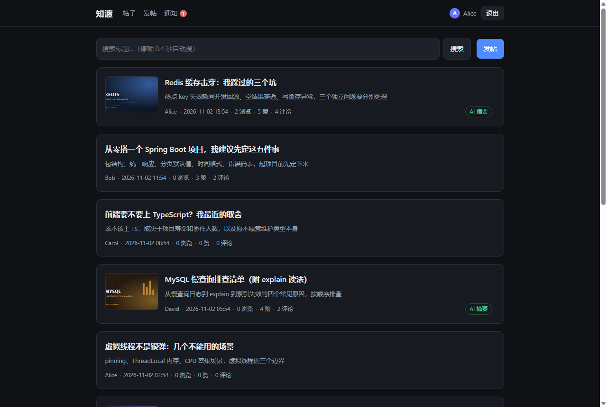
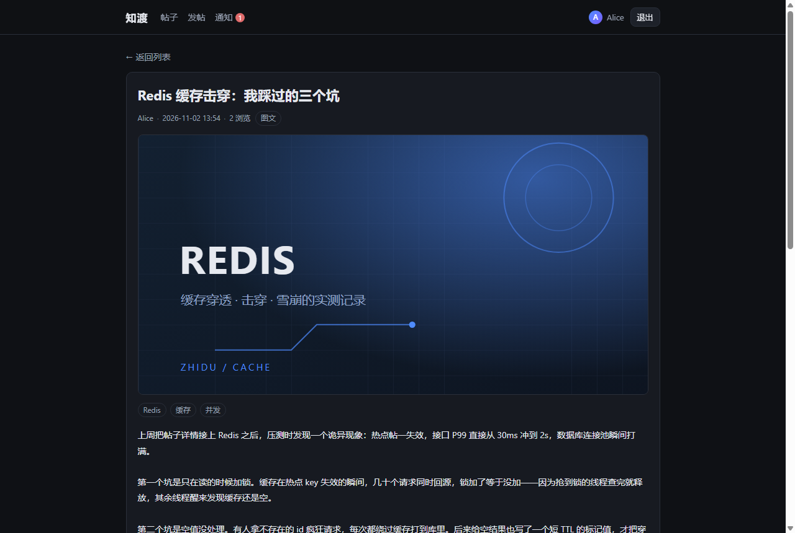
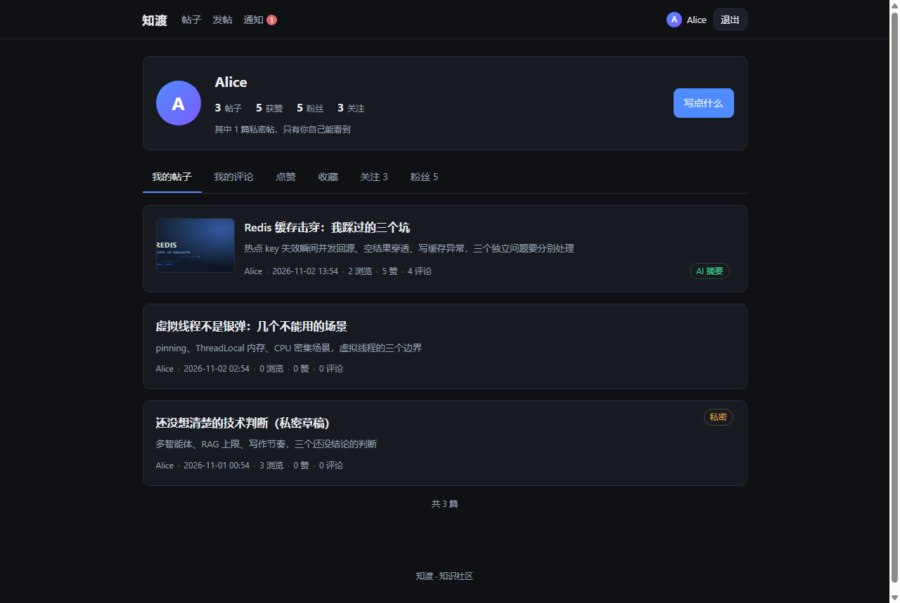
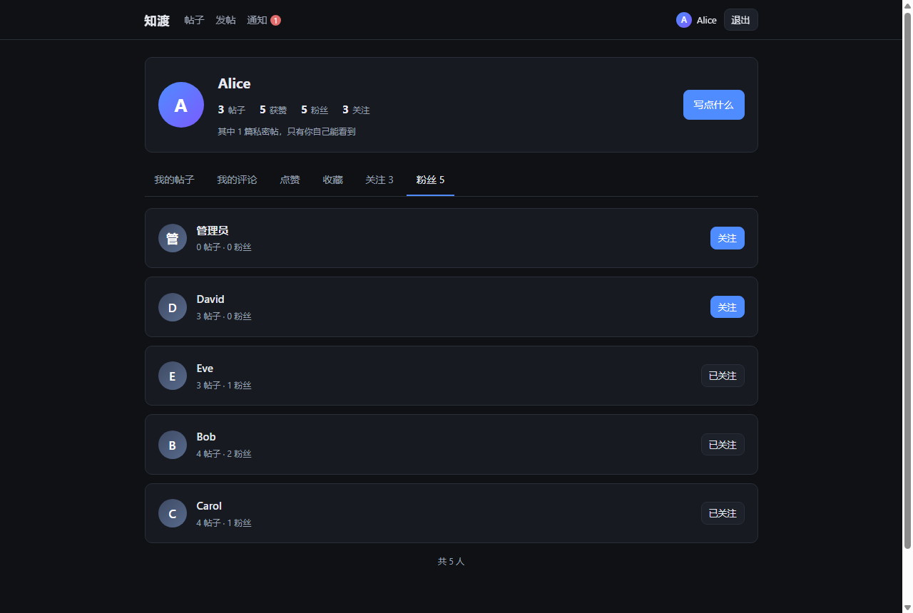
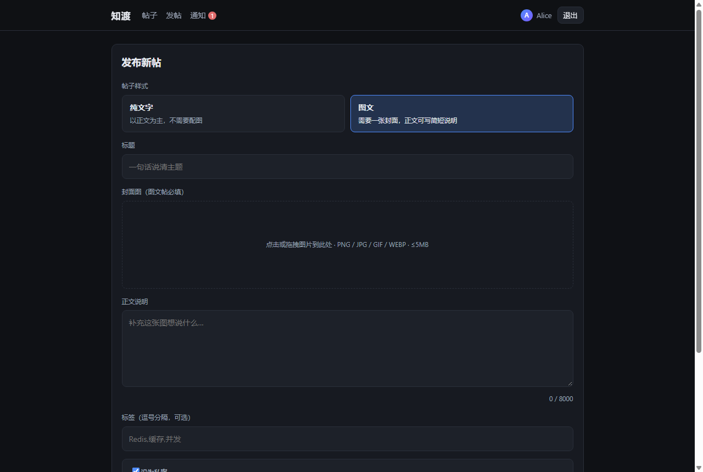
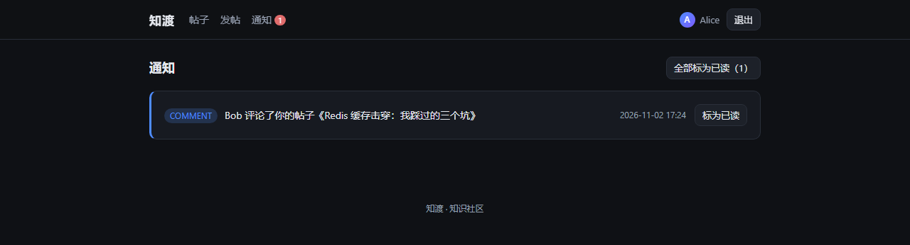
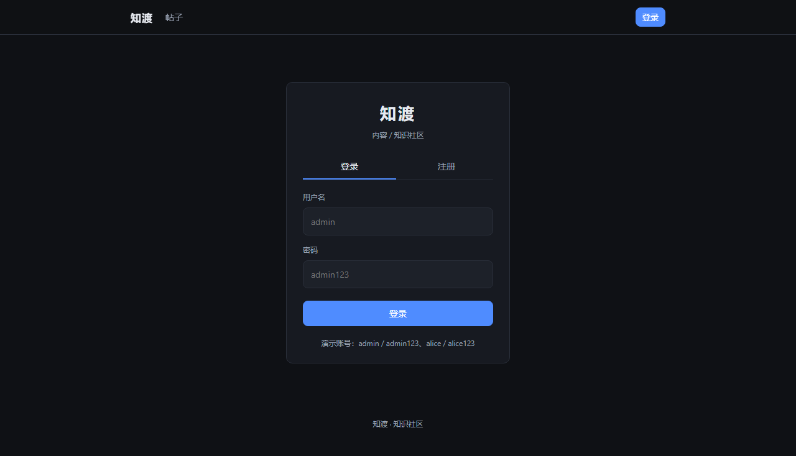

# 知渡（ZhiDu）—— 内容 / 知识社区



<p>
  
  
  
  
  
</p>

> 一个面向内容社区场景的全栈项目。围绕「读多写少、热点集中、写操作需幂等、外部模型不可靠」这四类典型特征做设计，
> 覆盖鉴权、内容、互动、通知与 AI 内容增强五个领域，并保证在**不装 MySQL / RabbitMQ** 的本地环境下也能完整跑起来。

---

> **实现状态校正（2026-11-09）**：本轮做了一次完备性评估并补齐缺口。原先若干「设计上写了、代码里没有」的能力已落地：
> 缓存 TTL 随机抖动、DeepSeek 连接/读取超时、`community.mq.type` 配置真正生效、评论与点赞通知在事务提交后投递、
> 消费端按业务键判重、点赞/收藏并发幂等、评论与浏览量原子计数、AI 合规不通过时跳过写回、
> `GET /posts/{id}/interaction` 匿名可读、客户端异常收敛为 4xx、限流 Lua 原子化且 Redis 故障 fail-open。
> 同时修掉三类实际缺陷：评论越权、Vue 版评论区/通知页失效、prod 启动阻断。
> 仍未实现的部分（MQ publisher confirm / 手动 ACK / 死信、AI 真实调用契约、Flyway、OpenAPI、CI）在第九节如实标注。

## 界面预览

真实运行的界面截图（本地起 `local` profile + React 前端采集，非设计稿）。

**首页列表** —— 图文帖带封面，纯文字帖只有标题与摘要，AI 增强过的帖子带绿色「AI 摘要」标签。



**帖子详情** —— 缓存兜底的读路径；「已赞 / 已收藏」按当前用户单独查询，不进公共缓存。



**个人中心** —— 一次登录看全自己的帖子（含私密，右上角有标记）、评论、点赞、收藏、关注与粉丝。



**粉丝与关注** —— 每行可直接关注/取关，关注关系用唯一索引保证重复点击幂等。



**发布帖子** —— 两种形态：纯文字长文、图文配封面；可一键设为私密，私密帖不进首页列表、只有作者能打开。



**通知** —— 评论、点赞异步解耦投递，未读数实时显示在导航栏。



**登录 / 注册** —— JWT 无状态鉴权，token 过期由请求层统一拦截并回跳登录页。



---

## 一、项目简介

内容社区的后端难点不在功能数量，而在几个具体的工程问题：

| 场景特征 | 带来的问题 |
| --- | --- |
| 读多写少 | 帖子详情是高频读，DB 容易成为瓶颈，需要缓存兜住 |
| 热点集中 | 少数帖承担大部分流量，热点 key 失效瞬间会把 DB 打穿（缓存击穿） |
| 写操作需幂等 | 点赞、通知这类动作重复触发不能产生脏数据 |
| 外部模型不可靠 | LLM 会超时、返回非 JSON、额度耗尽，不能让它拖垮主链路 |
| 本地开发环境受限 | 不能强制依赖外部中间件，否则根本无法启动 |

知渡就是围绕这五个问题搭起来的：**能用最少的外部依赖跑通，同时把每个问题的处理方式写清楚、可验证**。

---

## 二、技术栈

| 维度 | 选型 | 说明 |
| --- | --- | --- |
| 语言 / 框架 | Java 21 + Spring Boot 3.4.5 | 虚拟线程、Record、Jakarta |
| 持久层 | MyBatis-Plus 3.5.7 + MySQL 8（本地 H2 兼容模式） | 逻辑删除、分页插件、条件构造器 |
| 缓存 | Redis（Cache-Aside + 分布式锁） | 热点帖子缓存、防击穿、防穿透 |
| 异步解耦 | 本地虚拟线程异步 / RabbitMQ（`prod` 可切） | 发布即发通知，主链路不阻塞 |
| 安全 | Spring Security + JWT（HS256）+ RBAC | 无状态、方法级 `@PreAuthorize` |
| AI 能力 | 自研 DeepSeek 客户端（OpenAI 兼容协议） | 无 Key 或调用失败时规则降级 |
| 工程化 | Maven + JUnit5 + Mockito + Actuator | 自动化测试、可观测性、统一响应 |
| 文件存储 | 本地磁盘 + 静态资源映射（可替换为对象存储） | 魔数校验、UUID 重命名、按年月分目录 |
| 前端 | 双实现：Vue 3 + Vite 6（`frontend/`）、React 18 + TS + Vite 6（`frontend-react/`） | 同一套后端接口；React 版功能最全，Vue 版停留在上一轮功能范围，可并行启动做技术栈对比 |

---

## 三、快速开始

环境要求：**JDK 21**、**Redis 6379**、Maven 3.9+。前端另需 **Node 18+**。MySQL / RabbitMQ 仅在 `prod` profile 需要。

```bash
# 1. 打包
mvn -q -DskipTests package

# 2. 本地启动（H2 文件库 + 原生 Redis + 虚拟线程异步，无需 MySQL / MQ）
java -jar target/zhidu-community.jar --spring.profiles.active=local --server.port=8088

# 3.（可选）启动前端，二选一或同时启动
cd frontend && npm install && npm run dev          # Vue 3 版 → http://localhost:5173
cd frontend-react && npm install && npm run dev    # React 18 版 → http://localhost:5174
```

> 前端是独立工程，开发的 `/api` 请求由 Vite 代理到 `127.0.0.1:8088`。
> 只调接口不开前端也能用，接口前缀是 `http://127.0.0.1:8088/api`。
> 两版端口错开，可同时运行对照；它们连的是同一个后端，数据一致。

启动后：

- 接口前缀：`http://127.0.0.1:8088/api`
- H2 控制台：`http://127.0.0.1:8088/h2-console`（JDBC URL：`jdbc:h2:file:./data/community`）
- 健康检查：`GET /api/actuator/health`（`management` 为顶层配置，暴露 `health,info,metrics`；刻意不开放 `env` 以免泄露配置值）

**种子账号**（`local` / `test` 首次启动自动初始化，缺失的会按需补齐；`DataInitializer` 标注 `@Profile("!prod")`，生产环境不灌演示账号）：

| 用户名 | 密码 | 角色 |
| --- | --- | --- |
| admin | admin123 | ADMIN |
| alice | alice123 | USER |
| bob | bob123 | USER |
| carol | carol123 | USER |
| david | david123 | USER |
| eve | eve123 | USER |

同时灌入 18 篇帖子（6 篇图文 + 12 篇纯文字，其中 2 篇私密）、15 条评论、39 个点赞、8 条收藏、9 组关注关系，
每段都按业务键判重，重复启动不会产生重复数据。种子封面是随 jar 打包的 SVG（`static/seed/`），
所以 clone 下来不依赖任何外部图床就能看到完整页面。

> 老库升级：`data/community.mv.db` 里已有数据时，`schema-h2.sql` 末尾的 `ALTER TABLE ... ADD COLUMN IF NOT EXISTS`
> 会补上新增列，种子数据则按「作者 + 标题」逐条补齐，不会覆盖已有内容。

### 接口示例

```bash
# 登录拿 token
TOKEN=$(curl -s -X POST http://127.0.0.1:8088/api/auth/login \
  -H 'Content-Type: application/json' \
  -d '{"username":"admin","password":"admin123"}' | grep -o '"token":"[^"]*"' | sed 's/"token":"//;s/"//')

# 发帖（需登录）；postType: TEXT 纯文字 / IMAGE 图文，visibility: 0 公开 / 1 私密
curl -s -X POST http://127.0.0.1:8088/api/posts \
  -H "Authorization: Bearer $TOKEN" -H 'Content-Type: application/json' \
  -d '{"title":"Spring Boot 缓存实战","content":"讲解 Cache-Aside + 分布式锁防击穿","postType":"TEXT","visibility":0}'

# 帖子详情（公开，走 Redis 缓存；私密帖只有作者本人能读）
curl -s http://127.0.0.1:8088/api/posts/1

# AI 增强（无 Key 走规则降级，返回 summary / tags / safe）
curl -s -X POST http://127.0.0.1:8088/api/ai/posts/1/enhance -H "Authorization: Bearer $TOKEN"

# 个人中心：统计 / 我的帖子（含私密）/ 我的评论 / 点赞过 / 收藏过
curl -s http://127.0.0.1:8088/api/me/stats -H "Authorization: Bearer $TOKEN"
curl -s "http://127.0.0.1:8088/api/me/posts?current=1&size=10&includePrivate=true" -H "Authorization: Bearer $TOKEN"
curl -s http://127.0.0.1:8088/api/me/comments -H "Authorization: Bearer $TOKEN"
curl -s http://127.0.0.1:8088/api/me/likes -H "Authorization: Bearer $TOKEN"
curl -s http://127.0.0.1:8088/api/me/favorites -H "Authorization: Bearer $TOKEN"

# 收藏 / 取消收藏（返回切换后的状态）
curl -s -X POST http://127.0.0.1:8088/api/posts/1/favorite -H "Authorization: Bearer $TOKEN"

# 关注 / 取关、粉丝与关注列表
curl -s -X POST http://127.0.0.1:8088/api/user/2/follow -H "Authorization: Bearer $TOKEN"
curl -s http://127.0.0.1:8088/api/user/2/followers
curl -s http://127.0.0.1:8088/api/user/2/followees
```

---

## 四、系统设计

### 4.1 分层与模块

```
┌────────────┐   ┌─────────────────────────── 应用分层 ───────────────────────────┐
│  Controller │──▶│  Service(事务/幂等/缓存编排)  ──▶  Mapper(MyBatis-Plus)  ──▶ DB │
└────────────┘   │        │                          │                              │
                 │        ├──▶ PostCacheService ──▶ Redis（Cache-Aside + 分布式锁） │
                 │        ├──▶ ContentAiService ──▶ DeepSeek / 规则降级             │
                 │        └──▶ NotificationPublisher ──▶ 本地异步 / RabbitMQ         │
                 └─────────────────────────────────────────────────────────────────┘
                                  Security: JwtAuthFilter + @PreAuthorize(RBAC)
```

设计原则是**业务逻辑只留在 Service 层**：Controller 不写判断、Mapper 不写业务，缓存、事务、幂等、消息这些横切关注点由 Service 编排。旁路能力（缓存、AI、通知）各自独立为组件，便于单独替换与测试。

| 模块 | 能力 | 关键设计 |
| --- | --- | --- |
| `user` | 注册 / 登录 / 当前用户 / 用户分页 | BCrypt 加密、JWT 签发校验、RBAC 方法级鉴权 |
| `content` | 帖子 CRUD / 详情 / 评论 / 点赞 | 缓存防击穿、分布式锁、点赞幂等、计数原子更新 |
| `notify` | 通知列表 / 未读计数 / 已读 | 发布解耦，本地虚拟线程与 RabbitMQ 双实现可切换 |
| `ai` | 帖子摘要 / 标签 / 合规审核 | LLM 作为下游组件，失败或未配置时降级为规则实现 |

### 4.2 数据模型

| 表 | 作用 | 关键约束 |
| --- | --- | --- |
| `t_user` | 账号、密码、角色、状态 | `uk_user_username` 唯一 |
| `t_post` | 帖子正文与冗余计数（浏览/点赞/评论）；`post_type` 区分纯文字/图文，`visibility` 控制私密 | `idx_post_user`、`idx_post_status_ctime`、`idx_post_visibility_ctime` |
| `t_comment` | 评论，`parent_id` 支持两层结构 | `idx_comment_post` |
| `t_post_like` | 点赞关系 | `uk_like_post_user` 唯一索引兜底幂等 |
| `t_post_favorite` | 收藏关系 | `uk_favorite_post_user` 唯一索引兜底幂等 |
| `t_user_follow` | 关注关系（`follower_id` → `followee_id`） | `uk_follow_pair` 唯一索引，重复关注幂等 |
| `t_notification` | 站内通知 | `idx_notify_receiver` |

五个设计取舍：

1. **计数冗余在 `t_post` 上**（`like_count` / `comment_count` / `view_count`），避免列表页对明细表做聚合查询；代价是计数需要与明细保持一致，这一点在「难点二」里踩过坑。
2. **逻辑删除**用 `deleted` 字段，配合 MyBatis-Plus `@TableLogic` 自动过滤。
3. **表名统一 `t_` 前缀**，规避 MySQL 里 `user` / `post` / `comment` 这类保留字带来的转义麻烦。
4. **私密可见性放在服务端判断，不靠前端隐藏**：列表查询带 `visibility = 0` 条件，详情、点赞/收藏、评论与评论列表都再校验一次作者身份；「赞过 / 收藏过」列表的 SQL 也过滤 `visibility`，
   非作者拿到的错误是「帖子不存在」而不是「无权访问」——不泄露资源是否存在。私密帖**不写 Redis 缓存**，
   因为缓存是所有用户共享的，写进去等于泄露给下一个访问者。
5. **关注/收藏与点赞同构**：都是「关系表 + 唯一索引」，靠数据库唯一约束实现幂等，而不是先查后插。

### 4.3 关键链路

**读帖子详情（Cache-Aside + 防击穿）**

```
读 Redis → 命中且非空标记 → 直接返回
        → 未命中 → 尝试抢分布式锁
                 → 抢到 → 双重检查缓存 → 回源 DB → 累加浏览量 → 写缓存 → 返回
                 → 没抢到 → 短暂自旋等缓存回填 → 读到即返回 → 超时才兜底回源
```

**写帖子（写库删缓存）**

事务内更新 DB → 成功后删除对应缓存 key，读请求自然回源重建。用「删」而不是「改」，避免并发写导致的旧值覆盖。评论新增同样删除缓存（`PostVO` 带 `comment_count`）。

**点赞（唯一索引 + 原子计数）**

查是否存在 → 存在则删、不存在则插（`uk_like_post_user` 兜底防重复）→ **一条 SQL 原子更新计数** → 同步修正缓存中的计数。

**通知（发布者抽象 + 异步）**

业务侧只调用 `NotificationPublisher.publish()`，不关心怎么投递。`community.mq.type=local` 走虚拟线程异步、`rabbitmq` 切 MQ（由 `@ConditionalOnProperty` 装配，配置项真正生效）；通知在**事务提交后**才投递，避免回滚留下幽灵通知；消费端按 `receiver + type + refId` 判重（应用层实现，`t_notification` 暂无数据库唯一约束，后续迁移时补）。

**AI 增强（降级治理）**

调用 LLM → 成功则解析 JSON 写回帖子；超时、非 JSON、未配置 Key 三者任一发生，走规则实现（摘要截取、默认标签、关键词合规判定），主链路不受影响。超时由 `community.ai.timeout-seconds` 实际生效（`RestClient` 设置 connect/read timeout）；合规判定不通过时跳过写回，只把结果返回调用方。

**图片上传（先验类型，再落盘）**

```
客户端上传 → 大小校验 → 读文件头 12 字节按魔数判真实类型
          → 不在白名单 → 拒绝（60002）
          → 通过 → 服务端生成 UUID 文件名 → 落盘 data/uploads/yyyy/MM/
          → 返回 /api/uploads/yyyy/MM/<uuid>.png
```

发帖时 `coverImage` 只接受上述前缀的路径（正则白名单），传外链直接拒绝。

---

## 五、核心设计决策

### 1. 缓存问题分场景治理，不套一个方案

击穿、穿透、雪崩的成因不同，手段也不同：

| 问题 | 成因 | 手段 |
| --- | --- | --- |
| 击穿 | 单个热点 key 失效瞬间大量请求回源 | 分布式锁 + 自旋等待，只放一个线程回源 |
| 穿透 | 查询根本不存在的 ID，缓存永远不命中 | 空结果缓存短 TTL（空标记，1 分钟） |
| 雪崩 | 大量 key 同时过期 | 过期时间随机化 |

### 2. 分布式锁自研而非直接引框架

用 `SET NX PX` 抢锁，释放时用 Lua 脚本比对 value（UUID）后删除，避免误删他人的锁。相比直接引 Redisson，手写版本能更清楚地控制**抢不到锁时的行为**——而这恰好是「难点一」暴露问题的地方。生产环境若需要可重入与看门狗续期，换 Redisson 更省心。

### 3. 计数一致性下推给数据库

点赞数不用「读出来 +1 再写回」，而是交给一条 `UPDATE ... SET like_count = CASE ... END` 原子语句。并发控制由 DB 的行锁完成，应用层不需要额外加锁，也不会出现丢失更新。同理，`comment_count` 与 `view_count` 也交给原子 `UPDATE ... SET x = x + 1`，不再「读出来 +1 再写回」；浏览量只在回源时累加，保证 DB 是权威值。

### 4. 通知发布者抽象，本地开发零外部依赖

`NotificationPublisher` 是接口，`local` 用 `@Async` + 虚拟线程实现并标注 `@Primary`，`prod` 切 RabbitMQ 实现。好处是：本地开发不需要装 MQ，业务代码一行不用改，切换只靠 profile。

### 5. 把 LLM 当「概率性下游组件」治理

LLM 不是可靠依赖，它有超时、有非 JSON 输出、有额度耗尽。所以设计上：

- 客户端轻量自研（`RestClient` + OpenAI 兼容协议），不引入重框架；
- 所有失败路径都有规则降级，**降级结果是可用的，不是报错**；
- AI 增强是独立手动接口（`POST /ai/posts/{id}/enhance`），发帖主链路不触发；结果同步写回，但外部 HTTP 调用已移出数据库事务，不会长时间占用连接。

### 6. 多 profile 隔离，保证任何环境都能启动

| profile | 数据库 | 缓存 | 异步 |
| --- | --- | --- | --- |
| `local` | H2 文件库 | 本机 Redis | 虚拟线程 |
| `test` | H2 内存库 | 本机 Redis(db=1) | 虚拟线程 |
| `prod` | MySQL 8 | Redis | RabbitMQ |

`local` 与 `test` 都不需要 MySQL / RabbitMQ，这是能持续开发和持续集成的前提。

### 7. 上传文件的三道校验，都不相信客户端

| 校验点 | 不信任什么 | 做法 |
| --- | --- | --- |
| 类型 | `Content-Type` 可任意伪造 | 读前 12 字节按魔数判定，只放行 PNG / JPEG / GIF / WEBP |
| 文件名 | 原始文件名可能含 `../` 或可执行后缀 | 完全弃用，服务端生成 UUID，扩展名由魔数反推 |
| 落盘路径 | 子目录可能被越界 | 年月目录由服务端生成，落盘前再校验一次 `startsWith(root)` |

额外加了两道：单文件 5MB 上限（容器层 + 代码层各拦一次），以及上传接口的 Redis 限流——**上传是系统里唯一会写磁盘的入口，被刷等于硬盘被占满**。

封面图地址也做了白名单：只接受 `/api/uploads/yyyy/MM/<32位hex>.<ext>`，传外链直接报 `10001`。这不是防 SSRF（浏览器自己发请求，服务端不参与），而是保证图片来源可控、删帖时能找到对应文件。

---

## 六、关键难点与解决方法

这一节记录的是**实际踩到并且修掉的问题**，每个都配了可复现的验证手段。

### 难点一：防击穿方案本身制造了故障

**现象**：补并发集成测试时，20 个虚拟线程同时打一个已失效的热点 key，**19 个请求直接抛 `IllegalStateException`**。

**原因**：初版 `RedisLock.lock()` 抢不到锁就直接抛异常。设计文档里写的是"其余线程自旋等待"，但代码里根本没有自旋——文档与实现脱节。结果热点 key 一失效，瞬间就是一批 500，**比不加锁直接打 DB 还糟**。

**解决**：新增 `RedisLock#lockWithWait`：

- 抢到锁 → 双重检查缓存 → 回源 → 写缓存；
- 没抢到 → 每 20ms 重读一次缓存，最多 100 次（约 2s）；
- 自旋超时仍未读到 → 兜底自己回源。

兜底这一步是刻意的取舍：**可用性优先于「只回源一次」**。宁可极端情况下多一次回源，也不能让用户看到 500。

**验证**：`PostCacheBreakdownIntegrationTest` 断言「20 并发未命中后，DB 浏览量必须仍为 1」。因为浏览量只在回源时 +1，这条断言等价于「只回源了一次」，不需要给 Mapper 打桩。

### 难点二：并发点赞丢失更新

**现象**：10 个不同用户并发点赞同一帖子，最终 `like_count` **只剩 1**，9 次更新凭空消失；而 `t_post_like` 里明明有 10 行。

**原因**：计数用了「读-改-写」——`setLikeCount(getLikeCount() + 1)` 再 `updateById`。两个线程同时读到 0，各自写回 1，后者覆盖前者，典型的 lost update。

**解决**：改成一条原子 SQL，并把下界保护写进语句：

```sql
UPDATE t_post
SET like_count = CASE WHEN like_count + 1 < 0 THEN 0 ELSE like_count + 1 END
WHERE id = ?
```

并发控制交给数据库行锁，应用层不引入额外锁。取消点赞同理走 `- 1`。

**验证**：`LikeIdempotencyIntegrationTest` 断言不变式 **`t_post.like_count` 恒等于 `t_post_like` 的真实行数**，同时验证同一用户并发点赞不会产生重复行。

> 这两个测试都不是摆设：把实现改回旧写法，测试立刻变红（19/20 抛异常、计数 1 对 10）。用「回退验证」确认用例确实有效，而不是恰好通过。

### 难点三：建表脚本非幂等导致重启失败

**现象**：应用首次启动正常，**第二次启动直接失败**：

```
JdbcSQLSyntaxErrorException: Index "idx_post_user" already exists
```

**原因**：`CREATE TABLE` 写了 `IF NOT EXISTS`，但 `CREATE INDEX` 没写；而 `spring.sql.init.mode=always` 每次启动都会重放脚本。H2 是文件库，数据还在，索引自然重复。

**解决**：所有索引改 `CREATE INDEX IF NOT EXISTS`。

**衍生处理**：MySQL 的 `CREATE INDEX` **不支持** `IF NOT EXISTS`，所以 `schema-mysql.sql` 换了个思路——把索引和唯一键全部内联写在 `CREATE TABLE` 里，表已存在时整句跳过，脚本同样可以重复执行。

**验证**：重建后连续启动两次，健康检查均为 `UP`。

### 难点四：`context-path` 与安全规则的前缀错位

**现象**：配置 `context-path=/api` 后，除登录外全部接口返回 401。

**原因**：Spring Security 的 `requestMatchers` 匹配的是**剥离 context-path 之后的路径**。写成 `/api/auth/**` 永远匹配不到，于是连登录都被要求鉴权。

**解决**：匹配规则一律写不带 `/api` 的路径（`/auth/**`、`/posts`、`/comments/posts/*`）。

### 难点五：集成测试依赖真实 Redis，但不能让没装 Redis 的环境失败

**问题**：缓存与分布式锁的行为用 mock 验证没有意义，必须连真实 Redis；但 CI 上不一定有。

**解决**：新增 `RedisAvailability` 门卫，在 `@BeforeEach` 里 ping 一次，不通则 `assumeTrue` 跳过，测试标记为 skip 而不是 fail。并发场景统一用虚拟线程 + `CountDownLatch` 同时起跑；注意 `SecurityContextHolder` 是线程隔离的，每个线程要单独设置登录态。

### 难点六：加一个「封面图」字段，牵动了三个层次

**现象**：只往 `Post` 实体加一个 `coverImage` 字段，编译直接失败；改完编译通过后，第一次启动老库又插不进数据。

**原因**：字段是「加了一个」，影响却是三处——

1. **存储层**：`CREATE TABLE IF NOT EXISTS` 只对新库生效。已存在的 `t_post` 不会自动加列，启动后所有插入都会报「列不存在」。解决是在脚本末尾追加 `ALTER TABLE t_post ADD COLUMN IF NOT EXISTS cover_image VARCHAR(255)`（H2 支持，MySQL 8 不支持该语法，生产需人工执行）。
2. **缓存层**：老版本 `PostVO` 已经以 JSON 形式存在 Redis 里，反序列化到新 record 时新字段为 null。`default-property-inclusion: non_null` 又会让它在响应里直接消失——所以上线时要清理一次缓存，或者接受短期缺字段。
3. **代码层**：`PostVO` 是 record，`new PostVO(...)` 全是位置参数。加字段后 3 个构造点（详情、点赞后重建、空值哨兵）和 1 处测试辅助方法全部失配，编译器会逐个报出来 —— 这次是编译器帮忙兜住了，但如果漏了「点赞后重建」那一处，表现会是**点赞之后封面图凭空消失**，很难查。

**验证**：专门加了一条断言，点赞后再查详情，`coverImage` 仍在（`PostCacheService` 里那条重建逻辑最容易漏）。

**结论**：给缓存对象加字段从来不是「改一个类」这么简单，要同时想清楚 DB、缓存、构造点三处。

---

## 七、实测数据

> 工具：`benchmark.py`（Python 标准库，零三方依赖，client 与 server 共机）。
> 目标接口：`GET /api/posts/1`。环境：JDK 21 + 内嵌 Tomcat + 本地 H2（内存模式）+ 原生 Redis(6379)。

| 场景 | 并发 | 样本 | 平均 | p50 | p95 | p99 | 吞吐 |
| --- | --- | --- | --- | --- | --- | --- | --- |
| 缓存命中（预热后串行） | 1 | 300 | 13.2 ms | 15.4 ms | 16.5 ms | 26.0 ms | — |
| 缓存未命中（每次删 key 回源） | 1 | 100 | 10.0 ms | 4.3 ms | 22.5 ms | 27.4 ms | — |
| 缓存命中（高并发） | 40 | 2000 | 7.5 ms | 7.6 ms | 10.2 ms | 14.8 ms | **~2574 QPS** |

**关于这组数据的说明（比数字本身更重要）**

1. 本地 H2 是内存库，回源本身就是亚毫秒级，所以**命中与未命中的延迟差落在噪声里**（都在 5–15ms，p99 基本持平 ~26ms）。这不是缓存无效，而是本地环境测不出收益。
2. 缓存的真实价值在**规模化与 DB 保护**：换成网络 MySQL 后，未命中要多付 5–20ms 的往返，命中仍走 Redis；高并发下缓存能把 DB 的 QPS 降一个量级。
3. ~2574 QPS 是**单机、client 与 server 共机、未调优**的下限，只说明该接口没有明显性能陷阱。生产环境需结合连接池、索引、机器规格重新压测。

不编造数字：「MySQL 下缓存提速 X 倍」属于合理推断，不写进结论；本地测不出的差距就如实标注。

---

## 八、测试策略

```bash
mvn test
```

共 **31 个用例 / 7 个测试类**，分两类（本轮新增 `CommentVisibilityIntegrationTest` 4 例、`JwtTokenProviderTest` 2 例）。

### 纯单测（17 例，离线可跑）

| 测试类 | 覆盖点 |
| --- | --- |
| `JwtTokenProviderTest` | 签发 / 解析 / 过期 / 篡改失效 |
| `ContentAiServiceTest` | 无 Key 时规则降级、敏感词判定、长文摘要截断 |
| `FileStorageServiceTest` | 魔数识别、伪装类型拒绝、路径穿越免疫、体积上限、1 字节文件不越界 |

### 集成测试（14 例，需要真实 Redis；`test` profile 用 H2 内存库）

| 测试类 | 覆盖点 | 核心断言 |
| --- | --- | --- |
| `RedisLockIntegrationTest` | 互斥、防误删他人锁、自动过期防死锁、自旋等回源 | 20 线程并发只有 1 个真正回源，且无人抛异常 |
| `PostCacheBreakdownIntegrationTest` | 命中不回源、并发防击穿、空值防穿透 | 20 并发未命中后 DB 浏览量仍为 1 |
| `LikeIdempotencyIntegrationTest` | 点赞 toggle、并发计数一致、唯一索引兜底 | `like_count` 恒等于点赞表真实行数 |
| `CommentVisibilityIntegrationTest` | 私密帖评论/列表越权、并发评论计数一致 | 非作者拿到「帖子不存在」；`comment_count` 恒等于评论表真实行数 |

**为什么集成测试值得写**：缓存击穿和计数一致性这两类问题，用 mock 验证不了——mock 不会有并发竞争。只有连真实 Redis + 真实事务边界，才能复现出来。这两条测试也正是发现「难点一」「难点二」的直接原因。

**为什么上传测试值得写**：安全类校验的正确性无法靠「手动传一张图试试」确认——你正常操作永远不会上传一个伪装成 PNG 的木马。这类测试的价值在于**它测的是你没打算走的那条路**。

---

## 九、已知不足与改进方向

如实列出，按优先级排序。

> **本轮（2026-11-09）已修复且不再计入不足**：评论私密帖越权、「赞过/收藏过」列表泄露、评论与浏览量计数丢更新、
> Vue 版评论区/通知页失效与 401 不回跳、`management` 缩进错误导致 actuator 只暴露 1 个端点、
> prod 空 JWT 密钥无提示崩溃、prod 灌入弱口令种子账号、缓存雪崩无随机化、AI 超时是死配置、
> `community.mq.type` 是死配置、点赞无通知、消费端无判重、AI 合规结果无处置、
> 客户端异常误报 500、限流非原子且 Redis 故障拖垮登录、匿名读交互态被 401。

| # | 不足 | 影响 | 改进方向 |
| --- | --- | --- | --- |
| 1 | **RabbitMQ 链路未在真实 MQ 上验证** | `community.mq.type` 切换已生效，但 publisher confirm、手动 ACK、死信队列仍未实现；本机无 MQ，实际只验证了本地虚拟线程路径 | 起一个 RabbitMQ 实例，补可靠性配置与消息不丢/不重复的集成测试 |
| 2 | **AI 真实模型调用未验证** | 只验证了「无 Key 降级」这条路径；真实调用的超时、非 JSON、限流分支没有实测 | 用真实 Key 跑通，并针对异常响应补契约测试 |
| 3 | **图片存本地磁盘，无法水平扩展** | 多实例部署时，A 节点上传的图在 B 节点查不到，只能靠网关做会话粘滞兜底 | 抽 `FileStorageService` 接口，加对象存储（OSS / S3 / MinIO）实现 |
| 4 | **图片无压缩与缩略图** | 原图直出，列表页 112×78 的缩略位也在拉整张图，手机拍的照片单张 3–5MB，流量浪费明显 | 上传时生成多尺寸或接入图片处理服务；列表改用 `?w=240` 变体 |
| 5 | **删帖不回收图片文件** | 帖子删了，`data/uploads` 里的图还在，长期会积累孤儿文件 | 删帖时按 `coverImage` 反查删除；或定期跑对账任务清理无引用文件 |
| 6 | **缺少接口文档** | 没有 OpenAPI / Swagger，接口只能看代码或 curl | 接入 springdoc-openapi |
| 7 | **缺少数据库迁移工具** | schema 靠手工执行脚本，无版本管理，多环境部署容易漂移（本次加 `cover_image` 就是靠手写 `ALTER ... IF NOT EXISTS` 顶上的） | 引入 Flyway 或 Liquibase |
| 8 | **功能面偏窄** | 只有帖子 / 评论 / 点赞 / 通知 / 单图封面，缺搜索、关注与 feed 流、标签体系、内容审核流、富文本与正文内嵌图 | 按业务价值逐步补齐，优先做 feed 与搜索 |
| 9 | **压测数据说服力有限** | 单机共机 + H2 内存库，缓存收益无法在本地量化 | 接网络 MySQL 后重测，区分冷/热缓存场景 |
| 10 | **上传无病毒扫描与 EXIF 剥离** | 魔数只能确认「这是个图片」，无法排除图片解析器漏洞利用；EXIF 里可能带拍摄地点与设备信息 | 接入 ClamAV；上传时重编码以剥离元数据 |
| 11 | **JWT 无刷新与吊销机制** | 签发后只能等过期，无法主动失效 | 引入 refresh token + Redis 存 jti 黑名单 |
| 12 | ~~同一用户并发点赞会撞唯一索引~~ **本轮已修复** | 点赞/收藏均捕获 `DuplicateKeyException` 转为幂等成功，并加回归测试 | — |
| 13 | **无 CI/CD** | 没有流水线，测试与构建靠本地手动执行 | 接入 GitHub Actions：编译 + 单测 + 集成测试 |

---

## 十、生产部署（`prod` profile）

`application-prod.yml` 已预留 MySQL + RabbitMQ 配置：

```bash
# 前置：MySQL 8、RabbitMQ 3.x、Redis
java -jar zhidu-community.jar --spring.profiles.active=prod
```

要点：

- 表结构用 `src/main/resources/db/schema-mysql.sql`（MySQL 8 语法，与 H2 版字段一一对应；
  索引与唯一键内联声明，表已存在时整句跳过，脚本可重复执行）。
- `community.mq.type=rabbitmq` 启用 MQ 发布消费；`community.ai.api-key` 注入 DeepSeek Key 启用真实模型。
- JWT 密钥务必通过环境变量注入，不要提交到仓库；未注入或短于 32 字节时启动期 fail-fast 并给出提示（配置项见 `.env.example`）。

---

## 十一、目录结构

```
知渡/
├── pom.xml
├── benchmark.py                    # 压测脚本
├── src/main/java/com/luoxianjun/community
│   ├── common/                     # 统一响应、异常、Redis 锁、限流注解/切面
│   ├── config/                     # MyBatis-Plus 分页、异步(虚拟线程)、Security、数据源
│   ├── security/                   # JWT 工具、过滤器、RBAC
│   └── module/
│       ├── user/                   # 用户与鉴权
│       ├── content/                # 帖子/评论/点赞/收藏 + 缓存防击穿 + 个人中心聚合
│       ├── notify/                 # 通知异步解耦（本地 / RabbitMQ）
│       ├── file/                   # 图片上传（魔数校验 + UUID 落盘）
│       └── ai/                     # DeepSeek 客户端 + 内容增强（降级）
├── data/
│   ├── community.mv.db             # H2 文件库（运行时生成）
│   └── uploads/yyyy/MM/            # 上传的图片（运行时生成）
├── src/main/resources
│   ├── application.yml / -local.yml / -prod.yml / -test.yml
│   ├── static/seed/                # 种子帖封面 SVG（随 jar 打包，保证 clone 即有图）
│   └── db/
│       ├── schema-h2.sql
│       └── schema-mysql.sql
├── frontend/                       # Vue 3 + Vite 前端（独立工程，未跟进本轮新功能）
│   ├── src/views/                  # 登录 / 列表 / 详情 / 编辑 / 通知
│   ├── src/api.js                  # 接口封装（自动带 JWT）
│   └── README.md                   # 前端说明与部署方式
├── frontend-react/                 # React 18 + TypeScript 前端（独立工程，功能最全）
│   ├── src/api/                    # 请求层 + DTO 类型 + 接口清单
│   ├── src/auth/                   # Context + useReducer 的登录态
│   ├── src/hooks/                  # useAsync / useDebouncedValue
│   ├── src/pages/                  # 列表 / 详情 / 编辑 / 通知 / 登录 / 个人中心
│   └── README.md                   # React 版说明与差异对照
└── src/test/                       # 单测 + 依赖真实 Redis 的集成测试
```

> 包名保留 `com.luoxianjun.community`：`community` 与「社区」语义一致，改名会牵动全部源文件却无实质收益。
>
> 注意：本项目为VibeCoding开发
