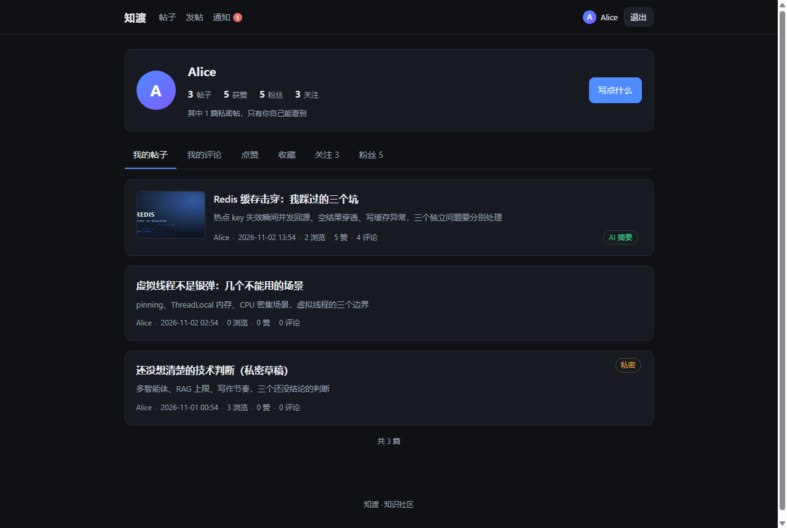
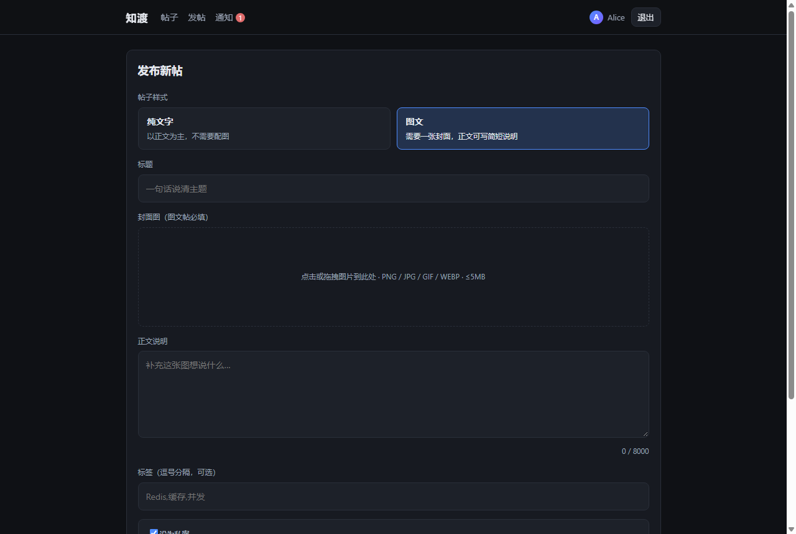

# 知渡前端 · React 版

知渡社区的第二个前端实现：**React 18 + TypeScript + Vite 6 + React Router 6**。
功能与 `../frontend/`（Vue 3 版）完全对齐，后端接口一套，两版可以同时跑起来做对比。

```bash
npm install
npm run dev        # http://127.0.0.1:5174
npm run typecheck  # tsc --noEmit
npm run build      # 类型检查 + 产出 dist
```

开发服监听 5174（Vue 版是 5173），`/api` 同样代理到 `http://127.0.0.1:8088`。

## 目录

```
src/
├── api/
│   ├── client.ts       统一请求：泛型返回、超时、AbortSignal、401 桥接
│   ├── endpoints.ts    接口清单
│   └── types.ts        与后端 record 一一对应的 DTO 类型
├── auth/
│   ├── AuthProvider.tsx  Context + useReducer 管登录态，集中持久化
│   ├── auth-context.ts   Context 定义（与组件分离，便于 HMR）
│   └── useAuth.ts
├── hooks/
│   ├── useAsync.ts      加载 / 错误 / 重跑 / 取消，五个页面共用
│   └── useDebouncedValue.ts
├── components/
│   ├── Layout.tsx       NavBar + Suspense 骨架
│   ├── NavBar.tsx       未读数随导航刷新 + 个人中心入口
│   ├── PostCard.tsx
│   ├── Pager.tsx        分页条（列表页与个人中心共用）
│   ├── ErrorBoundary.tsx
│   └── ToastProvider.tsx
├── pages/
│   ├── LoginPage.tsx
│   ├── PostListPage.tsx
│   ├── PostDetailPage.tsx   点赞 / 收藏 / 关注作者 / AI 摘要
│   ├── PostEditorPage.tsx   纯文字或图文 + 私密开关
│   ├── NotificationsPage.tsx
│   └── ProfilePage.tsx      个人中心：帖子 / 评论 / 点赞 / 收藏 / 关注 / 粉丝
├── styles/global.css    设计令牌 + 基础组件（与 Vue 版同一套视觉）
└── main.tsx
```

## 本轮新增功能

| 功能 | 说明 |
| --- | --- |
| 个人中心 `/me` | 头部统计（帖子 / 获赞 / 粉丝 / 关注）+ 6 个 tab，数字可点击直接切到对应 tab |
| 我的帖子 | 包含私密帖，右上角打「私密」标签；`includePrivate` 由后端按身份判定，前端传参不构成信任 |
| 我的评论 | 带所属帖子标题，点标题直达原帖 |
| 点赞 / 收藏 | 复用帖子卡片渲染，按点赞 / 收藏时间倒序 |
| 关注 / 粉丝 | 用户列表 + 关注按钮，关注后同时刷新列表与顶部统计 |
| 多种帖子样式 | 发布页可选「纯文字」或「图文」；图文必须有封面，正文输入框自动变矮成「正文说明」 |
| 私密帖 | 发布页开关；私密帖不进首页列表、详情只有作者能打开；详情页顶部有橙色提示条 |
| 收藏与点赞态 | 详情页独立查 `interaction` 拿「已赞 / 已收藏」状态，避免把用户态写进公共缓存 |

后端 `/comments/posts/{id}` 和 `/notifications` 返回的都是分页结构而非数组，React 版统一按 `records` 取。
Vue 版曾因直接当数组用导致评论区恒空、通知页渲染失败，该问题已在同一轮修复中同步处理。

界面截图见 `../docs/screenshots/` 目录，或直接看主 README 的「界面预览」章节。

| 个人中心 | 发布帖子（图文 + 私密） |
| --- | --- |
|  |  |


## 与 Vue 版的差异

| 维度 | Vue 3 版 | React 版 |
| --- | --- | --- |
| 语言 | JavaScript | TypeScript（strict + noUncheckedIndexedAccess） |
| 登录态 | `reactive` 单例，直接在模块里读写 localStorage | Context + useReducer，action 驱动，持久化收敛到一个 effect |
| 请求样板 | 每个视图各写一遍 loading / error / try-catch | `useAsync` 统一封装，页面只提供取数函数 |
| 请求取消 | 无，快速切换时旧响应可能覆盖新状态 | deps 变化或卸载即 abort，竞态从机制上消除 |
| 超时 | 无，后端卡住就一直转圈 | 15s 超时给出明确错误；AI 摘要单独放宽到 60s |
| 列表状态 | 页码 / 搜索词存在组件里，刷新即回第 1 页 | 写进 URL query，刷新、后退、分享都能复原 |
| 搜索 | 必须点按钮或回车 | 输入停顿 400ms 自动搜，回车立即搜 |
| 点赞 / 已读 | 等接口返回后整页重取 | 乐观更新 + 失败回滚，操作即时反馈 |
| 渲染异常 | 组件抛错即整树卸载，白屏 | `ErrorBoundary` 兜底，给出重试与返回入口 |
| 路由守卫 | 全局 `beforeEach` + `meta.requiresAuth` | `RequireAuth` 组合组件，保护范围就近可见 |
| 样式隔离 | `<style scoped>` | CSS Modules，类名编译期哈希 |
| 打包 | 单一 chunk | React 运行时单独分包 + 路由级懒加载 |
| 功能覆盖 | 登录 / 列表 / 详情 / 发帖 / 通知 | 在其基础上增加个人中心（6 个 tab）、关注、收藏、私密帖、图文/纯文字双样式 |

> Vue 版停留在上一轮的功能范围，没有跟进个人中心与私密帖。两版共用同一套后端接口，
> 需要补齐时可直接参照 `src/pages/ProfilePage.tsx` 与 `src/api/endpoints.ts`。

## 说明

- `dist/` 与 `node_modules/` 已在根 `.gitignore` 中排除。
- 开发模式下 `<StrictMode>` 会让 effect 执行两次，列表接口会在 dev 环境出现两次请求（生产构建不会）。这是 React 18 的刻意设计，用于暴露副作用清理问题。
- 类型只覆盖前端调用面，后端字段变更时需要同步 `api/types.ts`；这里没引入 openapi 生成器，属于已知取舍。
